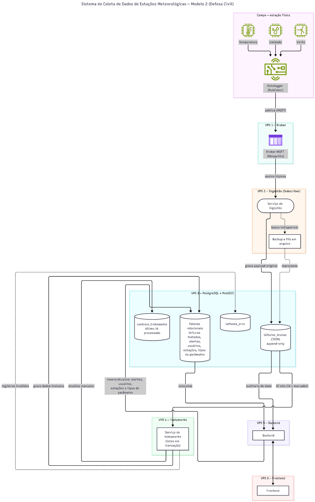

# KP-4DSM-API — Sistema de Monitoramento e Alertas de Desastres Naturais

## Equipe Kernel Panic

<div align="center">


[A Dor do Cliente](#a-dor) | 
[A Solução](#a-solução) |
[O Desafio](#o-desafio) | 
[Backlog de Produto](#backlog-de-produto) | 
[Backlog da Sprint](#backlog-da-sprint) | 
[Tecnologias](#tecnologias-utilizadas) |
[Arquitetura](#arquitetura-do-projeto) |
[Modelagem de Dados](#modelo-de-dados) |
[Estrutura do Projeto](#estrutura-do-projeto) | 
[Instalação](#manual-de-instalação) | 
[Documentação da equipe](#documentos) |
[Equipe](#autores)

</div>

---

<a id="a-dor"></a>
## 🎯 A Dor do Cliente

Tecsus — Expansão para o mercado de licitações

A Tecsus busca explorar o mercado de licitações públicas, oferecendo soluções tecnológicas voltadas ao monitoramento e à prevenção de desastres naturais. Para isso, precisa de uma plataforma que reúna funcionalidades relevantes para atender às necessidades dos órgãos públicos e apoiar sua participação nesse mercado.

Defesa Civil municipal — Monitoramento e resposta a desastres

Desastres naturais, como enchentes e deslizamentos, exigem monitoramento contínuo, dados confiáveis e respostas rápidas. A fragmentação das informações meteorológicas dificulta a identificação de riscos em tempo hábil, enquanto a falta de dados consolidados e de históricos acessíveis limita a análise das condições monitoradas e o apoio à tomada de decisão.

---

<a id="a-solução"></a>
## 🚀 A Solução

A equipe Kernel Panic propõe uma plataforma integrada de monitoramento e alerta de desastres naturais, que atende à estratégia de negócio da Tecsus e às necessidades operacionais das Defesas Civis municipais.

A solução reúne o gerenciamento de estações meteorológicas e sensores, a recepção e persistência de telemetria, a visualização centralizada de dados e a configuração de alertas para identificar condições que ultrapassem limites definidos.

Além disso, contempla funcionalidades de gestão de usuários e níveis de acesso, auditoria e rastreabilidade, gerenciamento de licitações e contratos e associação dos equipamentos aos respectivos contratos e órgãos públicos.

A plataforma também prevê a disponibilização de dados por APIs, a exportação de informações e a geração de relatórios históricos, de incidentes e de análises estatísticas comparativas. Dessa forma, busca oferecer uma visão consolidada das condições monitoradas, facilitar a identificação de situações de risco e apoiar a tomada de decisão.

---

<a id="o-desafio"></a>
## 🧩 O Desafio Proposto

O Sistema de Monitoramento e Alertas de Desastres Naturais tem como objetivo centralizar e integrar dados meteorológicos e geográficos provenientes de múltiplas estações de monitoramento, permitindo a detecção de anomalias e a emissão de alertas sobre enchentes, deslizamentos de terra e outros eventos extremos. A proposta busca ampliar a capacidade de prevenção e resposta dos órgãos governamentais, fornecendo informações confiáveis e atualizadas para a tomada de decisão.

A solução é uma aplicação web full-stack, com back-end desenvolvido em NestJS que disponibiliza APIs REST e executa processos de ingestão e tratamento de telemetria, além de um front-end responsivo. O sistema coleta, processa e disponibiliza dados de estações de monitoramento e mantém funcionalidades de alertas, rastreabilidade e auditoria. A proposta também considera a interoperabilidade com sistemas governamentais, as diretrizes e-PING e a proteção de dados conforme a LGPD; a implementação desses requisitos deve ser avaliada conforme o escopo entregue.

---

 <a id="backlog-de-produto"></a>
## 📋 Backlog de Produto

| Rank | ID | User Story | Prioridade | Sprint | Pontos | Status |
|------|----|-----------|-----------|--------|--------|--------|
| 1 | US01 | Gestão de Usuários, Autenticação e Níveis de Acesso | Alta | 1 | 11 | ✅ |
| 2 | US02 | Cadastro e Gerenciamento Dinâmico de Estações e Sensores | Alta | 1 | 11 | ✅ |
| 3 | US05 | Dashboard Interativo com Filtros e Indicadores Estatísticos | Alta | 1 | 12 | ✅ |
| 4 | US06 | Parametrização, Detecção e Histórico de Alertas de Risco | Alta | 1 | 16 | ✅ |
| 5 | US07 | Trilha de Auditoria Forense e Rastreabilidade | Alta | 1 | 13 | ✅ |
| 6 | US04 | Serviço de Recepção, Validação e Persistência de Telemetria | Alta | 2 | 10 | ✅ |
| 7 | US12 | Cadastro e Gestão de Licitações e Contratos | Alta | 2 | 9 | ✅ |
| 8 | US13 | Vínculo de Estações e Sensores aos Contratos | Alta | 2 | 9 | ✅ |
| 9 | IE14 | Planejamento e DevOps | Alta | 2 | 9 | ✅ |
| 10 | IE15 | Protótipo e Atualização de Telas | Alta | 2 | 9 | ✅ |
| 11 | US03 | Coleta e Transmissão via Datalogger Físico | Alta | 3 | 13 | ⏳ |
| 12 | US08 | Disponibilização de Dados Abertos e Interoperabilidade (e-PING) | Alta | 3 | 13 | ⏳ |
| 13 | US09 | Relatório de Histórico e Condições Climáticas Consolidadas | Média | 3 | 9 | ⏳ |
| 14 | US10 | Relatório de Incidentes e Ocorrências de Alertas | Média | 3 | 9 | ⏳ |
| 15 | US11 | Relatório Estatístico e Análise Comparativa | Média | 3 | 9 | ⏳ |

---

### Tasks por item do backlog

<details>
<summary><strong>US01 — Gestão de Usuários, Autenticação e Níveis de Acesso</strong></summary>

**Tasks vinculadas**

- Criação da página de login
- Endpoint de login (token armazenado http only)
- Modelagem do banco (tabela de usuários)
- Proteção global de login
- Busca e listagem de usuários
- Criação da tela de busca e listagem
- Cadastro de novos usuários

</details>

<details>
<summary><strong>US02 — Cadastro e Gerenciamento Dinâmico de Estações e Sensores</strong></summary>

**Tasks vinculadas**

- Criação da tela de cadastro de novas placas (estações meteorológicas e sensores)
- Cadastro de novas estações
- Modelagem do banco (tabelas relacionadas a estações)
- Busca e listagem de estações
- Tela de busca e listagem de estações
- Endpoint de recebimento dos dados das estações
- Criação de tela para cadastro de sensores

</details>

<details>
<summary><strong>US05 — Dashboard Interativo com Filtros e Indicadores Estatísticos</strong></summary>

**Tasks vinculadas**

- Criação da página do Dashboard
- Implementação dos filtros de período e estação
- Filtros de período e estação
- Implementação dos gráficos de dados metereológicos
- Implementação dos indicadores estatísticos
- Integração do Dashboard com os dados das estações

</details>

<details>
<summary><strong>US06 — Parametrização, Detecção e Histórico de Alertas de Risco</strong></summary>

**Tasks vinculadas**

- Criação da página de cadastro e gerenciamento dos alertas
- Cadastro de novos alertas
- Listagem de alertas
- Tela de busca e listagem de alertas
- Criação da tela de logs de alertas disparados (global)
- Criação da tela de logs de alertas disparados (específico)
- Back para recebimento de alertas

</details>

<details>
<summary><strong>US07 — Trilha de Auditoria Forense e Rastreabilidade</strong></summary>

**Tasks vinculadas**

- Modelagem do banco (tabela de logs de auditoria)
- Implementação do serviço de auditoria
- Criação da tela de consulta dos logs de auditoria
- Endpoint de consulta dos logs de auditoria
- Integração de auditoria com as funcionalidades da Sprint

</details>

<details>
<summary><strong>US04 — Serviço de Recepção, Validação e Persistência de Telemetria</strong></summary>

**Tasks vinculadas**

- **SCRUM-37** — Tornar as leituras brutas imutáveis no banco
- **SCRUM-38** — Evitar perda do lote em memória da ingestão
- **SCRUM-39** — Deduplicar reenvios do datalogger
- **SCRUM-40** — Validar a faixa física das leituras por tipo de parâmetro
- **SCRUM-41** — Tratar telemetria recebida de estação inativa
- **SCRUM-42** — Criar chave de ingestão individual por estação
- **SCRUM-43** — Medir ingestão via HTTP sob carga e otimizar o armazenamento de séries temporais
- **SCRUM-44** — Criar endpoint de health check da API e do banco
- **SCRUM-101** — Definir o formato do tópico e do payload MQTT
- **SCRUM-102** — Subir o broker Mosquitto com cadastro e ACL por estação
- **SCRUM-103** — Serviço de ingestão (subscriber MQTT) gravando só em leituras_brutas
- **SCRUM-104** — Serviço de tratamento em lotes com controle_tratamento, leituras_erro e licitacaoId
- **SCRUM-105** — Simulador de estações publicando no broker
- **SCRUM-106** — Repetir o teste de carga na nova cadeia (broker, ingestão e tratamento)
- **SCRUM-107** — Atualizar modelo de dados

</details>

<details>
<summary><strong>US12 — Cadastro e Gestão de Licitações e Contratos</strong></summary>

**Tasks vinculadas**

- **SCRUM-70** — Modelar órgãos públicos, licitações e contratos no banco
- **SCRUM-111** — Telas de licitações e de detalhe da licitação (no lugar de contratos e órgãos)
- **SCRUM-71** — CRUD de órgãos públicos no backend
- **SCRUM-72** — CRUD de contratos com validações de vigência no backend
- **SCRUM-73** — Listagem de contratos com filtros por status e órgão
- **SCRUM-74** — Criar tela de órgãos públicos
- **SCRUM-75** — Criar telas de listagem e cadastro de contratos
- **SCRUM-76** — Testes funcionais de órgãos e contratos
- **SCRUM-98** — Tornar as leituras brutas imutáveis no banco de dados
- **SCRUM-108** — Escrever as regras da licitação e revisar a US12 com o PO
- **SCRUM-109** — Migration do modelo por licitação (licitação com contrato e órgão, perfis e consistência)
- **SCRUM-110** — Módulo de licitações no backend: CRUD, encerrar e vincular estações
- **SCRUM-112** — Usuários por licitação: a Tecsus cadastra admins e o admin da licitação cadastra usuários comuns
- **SCRUM-113** — Telas com escopo por licitação, paginação, alertas ligados à API e responsividade

</details>

<details>
<summary><strong>US13 — Vínculo de Estações e Sensores aos Contratos</strong></summary>

**Tasks vinculadas**

- **SCRUM-77** — Modelar o vínculo entre contratos e estações no banco
- **SCRUM-78** — Rotas para vincular e desvincular estações de um contrato
- **SCRUM-80** — Tela de detalhe do contrato com estações e sensores vinculados
- **SCRUM-79** — Rota de hierarquia Contrato -> Estações -> Sensores
- **SCRUM-81** — Testes funcionais do vínculo entre contrato e estações

</details>

<details>
<summary><strong>IE14 — Planejamento e DevOps</strong></summary>

**Tasks vinculadas**

- **SCRUM-14** — Padronização inicial dos documentos de centralização de conhecimento
- **SCRUM-84** — Criação e edição da documentação DevOps para banco de dados
- **SCRUM-93** — Limpeza e correção de arquivos na pasta docs e do README
- **SCRUM-89** — Criação de testes unitários e funcionais no frontend
- **SCRUM-85** — Definição de Pipeline CI seguindo os padrões de documentação e fluxo do time
- **SCRUM-90** — Criação de integração da pipeline com o fluxo de rastreabilidade de requisitos
- **SCRUM-91** — Aplicação das regras definidas de forma automática, correções nas actions e regras do repositório
- **SCRUM-94** — Integração de Pipeline com o JIRA: Mover ticket para concluído quando PR aprovado
- **SCRUM-95** — Fix de divergência entre versões do node na pipeline de CI
- **SCRUM-96** — Processo de Monitoramento de DevOps
- **SCRUM-115** — Aplicação e documentação sobre banco de dados na branch principal

</details>

<details>
<summary><strong>IE15 — Protótipo e Atualização de Telas</strong></summary>

**Tasks vinculadas**

- **SCRUM-97** — Estilização da tela de login
- **SCRUM-83** — Criar novas telas no protótipo do projeto
- **SCRUM-92** — Atualizar NavBar

</details>

<details>
<summary><strong>US03 — Coleta e Transmissão via Datalogger Físico</strong></summary>

**Tasks vinculadas**

_Adicionar os IDs e títulos das tasks correspondentes no Jira._

</details>

<details>
<summary><strong>US08 — Disponibilização de Dados Abertos e Interoperabilidade (e-PING)</strong></summary>

**Tasks vinculadas**

_Adicionar os IDs e títulos das tasks correspondentes no Jira._

</details>

<details>
<summary><strong>US09 — Relatório de Histórico e Condições Climáticas Consolidadas</strong></summary>

**Tasks vinculadas**

_Adicionar os IDs e títulos das tasks correspondentes no Jira._

</details>

<details>
<summary><strong>US10 — Relatório de Incidentes e Ocorrências de Alertas</strong></summary>

**Tasks vinculadas**

_Adicionar os IDs e títulos das tasks correspondentes no Jira._

</details>

<details>
<summary><strong>US11 — Relatório Estatístico e Análise Comparativa</strong></summary>

**Tasks vinculadas**

_Adicionar os IDs e títulos das tasks correspondentes no Jira._

</details>

---

<a id="backlog-da-spint"></a>
## 📋 Backlog da Sprint 1
| ID | User Story | Prioridade | Sprint | Pontos | Status | Meta da Sprint |
|----|-----------|-----------|--------|--------|--------|----------------|
| US01 | Gestão de Usuários, Autenticação e Níveis de Acesso | Alta | 1 | 11 | ✅ | Meta |
| US02 | Cadastro e Gerenciamento Dinâmico de Estações e Sensores | Alta | 1 | 11 | ✅ | Meta |
| US05 | Dashboard Interativo com Filtros e Indicadores Estatísticos | Alta | 1 | 12 | ✅ | Meta |
| US06 | Parametrização, Detecção e Histórico de Alertas de Risco | Alta | 1 | 16 | ✅ | Meta |
| US07 | Trilha de Auditoria Forense e Rastreabilidade | Alta | 1 | 13 | ✅ | Não é meta |

## 📋 Backlog da Sprint 2
| ID | User Story | Prioridade | Sprint | Pontos | Status | Meta da Sprint |
|----|-----------|-----------|--------|--------|--------|----------------|
| US04 | Serviço de Recepção, Validação e Persistência de Telemetria | Alta | 2 | 11 | ✅ | Meta |
| US12 | Cadastro e Gestão de Licitações e Contratos | Alta | 2 | 9 | ✅ | Meta |
| US13 | Vínculo de Estações e Sensores aos Contratos | Alta | 2 | 9 | ✅ | Meta |
| IE14 | Planejamento e DevOps | Alta | 2 | 9 | ✅ |  Não é meta |
| IE15  | Protótipo e Atualização de Telas | Alta | 2 | 9 | ✅ |  Não é meta |

---

<a id="tecnologias-utilizadas"></a>
## 💻 Tecnologias Utilizadas

### 🎨 Frontend
<p>


</p>

### ⚙️ Backend
<p>


</p>

### 📊 Dados & DevOps
<p>


</p>

---

<a id="arquitetura-do-projeto"></a>
## 🛠  Arquitetura do Projeto



---

<a id="modelo-de-dados"></a>
## 📊  Modelagem de Dados do Projeto


---

<a id="estrutura-do-projeto"></a>
## 🗂️ Estrutura do Projeto

```
KP-4DSM-API
│
├── 📁 broker/                 → Broker MQTT Mosquitto (VPS 1): configuração e inicialização
├── 📁 frontend/               → Aplicação Next.js (VPS 6)
│   ├── 📁 app/               → Páginas e rotas
│   │   ├── 📁 (protegido)/   → Rotas autenticadas (e a pública de alertas globais)
│   │   └── 📁 login/         → Página de login
│   ├── 📁 components/        → Componentes React reutilizáveis
│   ├── 📁 lib/               → Utilitários, serviços da API e regras de perfil
│   ├── 📁 public/            → Arquivos estáticos
│   └── 📁 test/              → Testes unitários (Vitest) e funcionais (Playwright)
│
└── 📁 kernelpanic-backend/
    ├── 📁 src/                → API NestJS (VPS 5): consultas, CRUD, auditoria
    │   ├── 📁 autenticacao/   → JWT, perfis e escopo por licitação
    │   ├── 📁 licitacoes/     → Licitações (contrato e órgão), encerramento e vínculo de estações
    │   ├── 📁 broker/         → Cadastro das estações no broker (dynamic-security)
    │   └── 📁 …               → usuarios, estacoes, sensores, alertas, alarmes, dashboard, leituras-brutas, auditoria
    ├── 📁 servicos/
    │   ├── 📁 ingestao/       → Serviço de ingestão (VPS 2): assina o broker e grava leituras_brutas
    │   └── 📁 tratamento/     → Serviço de tratamento (VPS 4): leituras_brutas → medidas
    ├── 📁 prisma/             → Schema, seed e migrations
    ├── 📁 teste-carga/        → Simulador de estações (MQTT) e testes de carga
    └── 📁 test/               → Testes unitários e funcionais
```

A cadeia de dados (broker → ingestão → tratamento) está descrita em [docs/mqtt-topico-payload.md](docs/mqtt-topico-payload.md), e o modelo por licitação (perfis, escopo e ciclo de vida) em [docs/regras-licitacao.md](docs/regras-licitacao.md).

---

<a id="manual-de-instalação"></a>
## 📖 Manual de Instalação

### 🔧 Pré-requisitos

- Node.js 18+ 
- npm ou yarn
- PostgreSQL 14+
- Git

### 📦 Clonando o repositório

```bash
git clone https://github.com/Kernel-Panic-FatecSjc/KP-4DSM-API.git
cd KP-4DSM-API
npm install   # ferramentas de commit da raiz; também ativa o hook de validação
```

### ▶️ Subindo o sistema em desenvolvimento

```bash
cd kernelpanic-backend
cp .env.example .env                 # ajuste se precisar
docker compose up -d                 # Postgres + broker MQTT
npx prisma migrate deploy && npm run db:seed   # usuário inicial ADMIN_TECSUS
npm run start:dev                    # API na porta 3001
npm run build:servicos
npm run start:ingestao               # outro terminal: ingestão (3002)
npm run start:tratamento             # outro terminal: tratamento (3003)
npm run simulador                    # opcional: estações simuladas publicando no broker

cd ../frontend/frontend && npm install && npm run dev   # frontend na porta 3000
```

### 📝 Fazendo commits

Os commits seguem o formato `tipo(SCRUM-{ID}): descrição`, que é validado pela CI em todos os PRs. O `SCRUM-{ID}` corresponde ao ID da tarefa no Jira e deve ser o mesmo utilizado no nome da branch e no título do PR, mantendo o vínculo entre o código e a tarefa. Consulte o [padrão de commit](https://github.com/Kernel-Panic-FatecSjc/KP-4DSM-API/blob/main/docs/padraocommit.md) para mais detalhes.

Para criar um commit seguindo o padrão, adicione primeiro as alterações ao stage e, na raiz do projeto, em `kernelpanic-backend/` ou `frontend/frontend/`, execute:

```bash
git add <arquivos>
npm run commit
```

O comando `npm run commit` utiliza o Commitizen para auxiliar na criação da mensagem. Durante o processo, serão solicitados:

* **tipo**: categoria da alteração, como `feat`, `fix`, `docs`, `style`, `refactor`, `test`, `chore` ou `ci`;
* **ID da tarefa**: ID da tarefa no Jira, que será utilizado como escopo do commit no formato `SCRUM-{ID}`;
* **descrição**: breve descrição da alteração realizada.

Por exemplo, para uma tarefa de ID `123`, um commit de implementação de uma nova funcionalidade será:

```text
feat(SCRUM-123): Implementação do novo componente de autenticação
```

Também é possível utilizar `git commit` diretamente. Nesse caso, o hook `commit-msg` valida a mensagem antes de criar o commit e recusa aquelas que não estiverem de acordo com o padrão definido.

Caso a mensagem seja recusada, utilize:

```bash
npx cz --retry
```

Esse comando permite refazer o processo de criação do commit utilizando as respostas informadas anteriormente.

<a id="documentos"></a>
## Documentação da equipe

- [DoR (Definition of Ready)](https://github.com/Kernel-Panic-FatecSjc/KP-4DSM-API/wiki/Definition-Of-Ready)
- [DoD (Definition of Done)](https://github.com/Kernel-Panic-FatecSjc/KP-4DSM-API/wiki/Definition-Of-Done)
- [Padrão de Commit](https://github.com/Kernel-Panic-FatecSjc/KP-4DSM-API/wiki/Padr%C3%A3o-de-Commit)
- [Rastreabilidade de Requisitos](https://github.com/Kernel-Panic-FatecSjc/KP-4DSM-API/wiki/Rastreabilidade-de-requisitos)
- [Mapeamento e Especificação Técnica de Requisitos](https://github.com/Kernel-Panic-FatecSjc/KP-4DSM-API/wiki/Requisitos)
- [Estratégia de Branch](https://github.com/Kernel-Panic-FatecSjc/KP-4DSM-API/wiki/Estrat%C3%A9gia-de-Branch)
- [Entrega contínua e deploy (CD)](https://github.com/Kernel-Panic-FatecSjc/KP-4DSM-API/wiki/Entrega-continua-e-deploy)
- [Integração contínua (CI)](https://github.com/Kernel-Panic-FatecSjc/KP-4DSM-API/wiki/Integracao-continua)
- [Banco de dados](https://github.com/Kernel-Panic-FatecSjc/KP-4DSM-API/wiki/Banco-de-dados)
- [Gestão de Documentos](https://github.com/Kernel-Panic-FatecSjc/KP-4DSM-API/wiki/Gest%C3%A3o-de-Documentos)
- [Gestão de Processo](https://github.com/Kernel-Panic-FatecSjc/KP-4DSM-API/wiki/Gest%C3%A3o-de-Processo)

---

<a id="autores"></a>
## 👨‍💻 Autores

Equipe de Desenvolvimento 4DSM - FATEC São José dos Campos

| Nome | Função | DevOps| Contato |
|------|--------|--------|--------|
| [Rebeca Lima] | Product Owner | QA (Quality Assurance) | [GitHub](https://github.com/rebeca-lima-ti) |
| [Vitor Serpa] | Scrum Master | CI | [GitHub](https://github.com/VitorSerpa) |
| [Gabriel Lázaro] | Desenvolvedor | Testes | [GitHub](https://github.com/gabsact4) |
| [Henry Tito] | Desenvolvedor | CD | [GitHub](https://github.com/HenryTito) |
| [Miguel Nonaka] | Desenvolvedor | BD (Banco de Dados) | [GitHub](https://github.com/miguelnonaka) |
| [Maria Fernanda Laboissiere] | Desenvolvedor | Monitoramento | [GitHub](https://github.com/mariaflbss) |
| [Paula Tamay] | Desenvolvedor | Docs | [GitHub](https://github.com/PaulaEmy/PaulaEmy) |
| [João Victor dos Reis] | Desenvolvedor | Rastreabilidade de Requisitos | [GitHub](https://github.com/Templasan) |