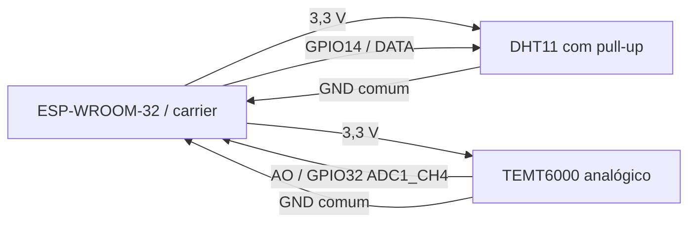

# SCRUM-30 — inventário e montagem do protótipo

Este registro separa os dados informados pelo usuário das verificações ainda pendentes. Não é um esquema elétrico aprovado.

## Inventário da bancada

| Item | Informação confirmada/informada | Situação |
| --- | --- | --- |
| ESP32 | ESP-WROOM-32; Xtensa LX6 dual-core, flash de 4 MB | Firmware compilado e gravado na COM3 |
| Carrier verde | Feita para ESP-WROOM-32 | Modelo e esquema não identificados; continuidade dos sinais não verificada |
| DHT11 | GPIO14, VCC 3,3 V, pull-up e GND comum | Driver configurado; quadros recentes incompatíveis com a resolução/faixa foram descartados. Um quadro anterior gerou 2,5 °C/3% RH e foi enfileirado antes da validação mais estrita |
| TEMT6000 | GPIO32, saída analógica, VCC 3,3 V e GND comum; usuário informa limite de 3,3 V | ADC1_CH4 configurado; contagens 1296, 1203 e 1223 observadas; conversão/calibração em lux pendente |
| Módulo azul no Módulo_4 | Terminais VCC/I/O/GND, modelo não legível | Não usar como sensor nem acionar; possível GPIO35 não confirmado por esquema |

## Ligações informadas para a bancada

O desenho representa os fios informados pelo usuário; não valida trilhas internas da carrier nem valor/posição do pull-up do módulo DHT11.

GPIO14 é usado como sinal digital do DHT11, então a limitação do ADC2 com Wi-Fi não se aplica. GPIO32 corresponde a ADC1_CH4. A tabela oficial de [GPIO do ESP-IDF](https://docs.espressif.com/projects/esp-idf/en/v5.4/esp32/api-reference/peripherals/gpio.html) descreve essas funções. O ADC está em atenuação de 12 dB; a faixa de melhor precisão no ESP32 vai até aproximadamente 2,45 V segundo o [datasheet do ESP32-WROOM-32](https://documentation.espressif.com/esp32-wroom-32_datasheet_en.html). O limite informado de alimentação do módulo não substitui a medição da tensão de saída analógica.

## Pendências para fechar SCRUM-30

- Identificar modelo/revisão da carrier e obter esquema ou verificar continuidade entre conectores e GPIOs.
- Investigar por que o DHT11 fornece quadros inválidos; conferir sinal/VCC/GND e comparar temperatura/umidade com instrumento de referência.
- Medir a tensão de saída do TEMT6000 em condições de luz distintas e calibrar em lux se necessário.
- Confirmar os parâmetros cadastrados na estação: `temperatura_c`, `umidade_pct` e `luminosidade_adc`. O firmware está configurado com fator 1 e ganho 0 para os três; luminosidade representa contagem ADC, não lux.
- Se o requisito for lux, obter circuito/resistência e calibração contra instrumento de referência.
- Definir pelo time tolerância de comparação, e anexar evidência de montagem/leitura individual.

## Lista conhecida

| Quantidade | Componente | Função/configuração |
| --- | --- | --- |
| 1 | ESP-WROOM-32 | Controlador, flash de 4 MB informada |
| 1 | Carrier verde | Modelo e esquema pendentes |
| 1 | DHT11 | Temperatura e umidade, GPIO14, 3,3 V, pull-up informado |
| 1 | TEMT6000 | Luz ambiente, saída analógica no GPIO32, 3,3 V informado |
| 1 | Módulo azul, Módulo_4 | Não identificado; fora da aquisição |

Há evidência parcial de execução na placa, mas sem esquema revisado e sem leitura válida do DHT11. SCRUM-30 não está totalmente concluída.
