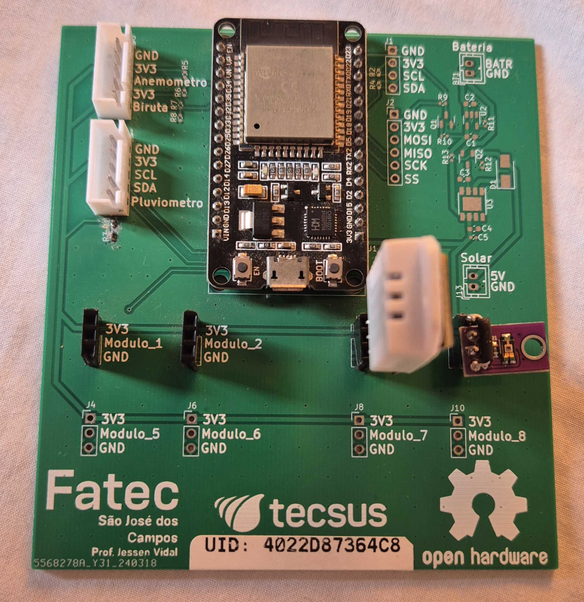
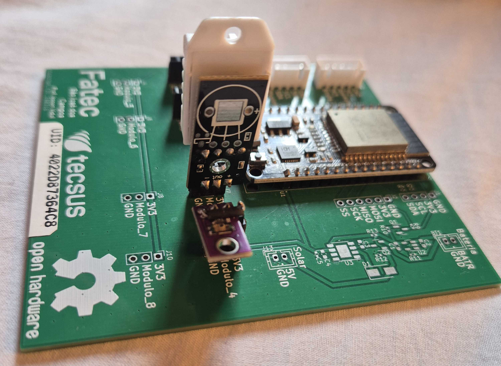
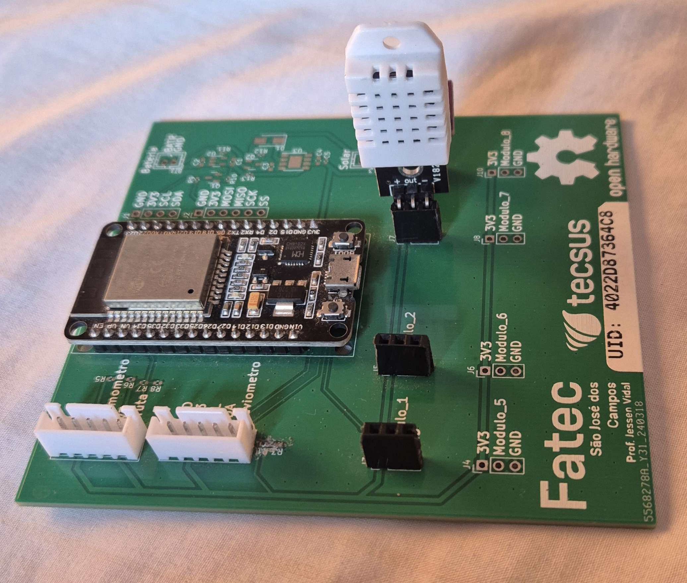

# Hardware do protótipo (SCRUM-30)

Protótipo em bancada do Data Logger: ESP32 + DHT22.

## Módulo ESP32

| Característica | Valor | Compatibilidade com os sensores |
| --- | --- | --- |
| Módulo | ESP-WROOM-32 em carrier verde  | — |
| Processador / memória | Dual-core até 240 MHz, 520 KB SRAM, flash de 4 MB | Fila persistente usa ~2,9 MB da flash (partição `telemetry`) |
| Rede | Wi-Fi 2,4 GHz 802.11 b/g/n | Transmissão MQTT |
| Lógica / alimentação | 3,3 V (regulador da carrier a partir do USB 5 V) | DHT22 opera de 3,3 a 6 V: ligado em 3,3 V, sem conversor de nível |
| Interfaces | GPIO digitais, ADC1 (GPIO32–39), UART, I2C, SPI | DHT22 usa 1 GPIO digital (protocolo de 1 fio) |
| Ambiente de desenvolvimento | PlatformIO, ESP-IDF 5.4, placa `esp32dev` | — |

## Lista de materiais

| Qtd | Componente | Especificação | Função na coleta | Parâmetro no Data Panic |
| --- | --- | --- | --- | --- |
| 1 | ESP-WROOM-32 em carrier | 4 MB flash, USB-serial na carrier | Aquisição, relógio, buffer e transmissão | — |
| 1 | DHT22 (AM2302) | 3,3–6 V; -40 a 80 °C (±0,5 °C); 0–100 % UR (±2–5 %); 1 leitura a cada ≥ 2 s | Temperatura e umidade do ar | `temperatura_c` (°C) e `umidade_pct` (%) |
| 1 | Resistor de pull-up | Requer um resistor de pull-up entre 4,7 kΩ e 10 kΩ | Mantém a linha de dados em nível alto | — |
| 1 | Protoboard e jumpers | — | Montagem em bancada | — |
| 1 | Cabo USB | Dados + alimentação 5 V | Gravação, monitor serial e alimentação | — |

Fora da montagem: módulo azul não identificado (Módulo_4), não ligado a nenhum GPIO ativo e não lido pelo firmware.

## Esquema elétrico

```
                 ESP32 (ESP-WROOM-32 / carrier)
                 ┌─────────────────────────────┐
   USB 5 V ─────►│ 5V/VIN    regulador → 3V3   │
                 │                             │
                 │ 3V3 ●────────────┬──────────┼──────────► DHT22 pino 1 (VCC)
                 │                  │          │
                 │                 [R] pull-up │ 
                 │                  │          │
                 │ GPIO14 ●─────────┴──────────┼──────────► DHT22 pino 2 (DATA)
                 │                             │            DHT22 pino 3 (NC)
                 │ GND ●───────────────────────┼──────────► DHT22 pino 4 (GND)
                 └─────────────────────────────┘
```

| Sinal | ESP32 | DHT22 | Observação |
| --- | --- | --- | --- |
| Alimentação | 3V3 | Pino 1 (VCC) | Alimentação a penas por 3,3V |
| Dados | GPIO14 | Pino 2 (DATA) | Pull-up entre DATA e 3V3; o firmware também ativa o pull-up interno |
| — | — | Pino 3 (NC) | Não conectado |
| Terra | GND | Pino 4 (GND) | Terra comum |

Em módulos DHT22 de 3 pinos (já com resistor), a ordem costuma ser `+`, `out`, `-`; confira a serigrafia. O GPIO14 foi informado na montagem; 

## Cadastro no Data Panic

| Sensor | Nome do tipo de parâmetro | Unidade | Fator / ganho | Faixa física recomendada |
| --- | --- | --- | --- | --- |
| DHT22 – temperatura | `temperatura_c` | °C | 1 / 0 | -40 a 80 |
| DHT22 – umidade | `umidade_pct` | % | 1 / 0 | 0 a 100 |

A faixa física é a faixa válida do sensor; limites de alerta (ex.: temperatura > 28 °C) ficam no alerta, não na faixa.

## Testes individuais e fotos

- [x] Log do monitor serial com leituras do DHT22 — ver [evidencias/SCRUM-35-execucao-2026-11-16.md](evidencias/SCRUM-35-execucao-2026-11-16.md) (cenário 1).
- [ ] Comparação com instrumento de referência: **não realizada** — não há instrumento de referência disponível no projeto; a tolerância também não foi definida. Registrado como limitação da validação.
- [x] Fotos da montagem — ver seção abaixo.

## Fotos da montagem

| Vista superior | Lado direito | Lado esquerdo |
| --- | --- | --- |
|  |  |  |
